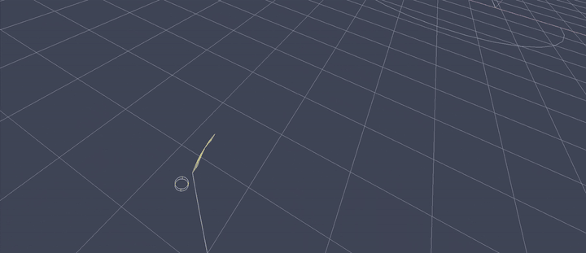
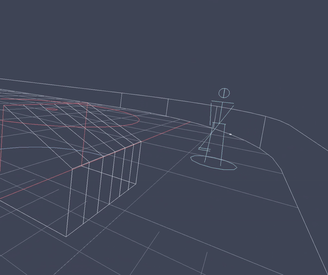

# vr-hockey



*The sandbox in the headset (the mirror view): a virtual stick held with two Quest 3
controllers, stickhandling a puck and shooting at the net.*

A VR hockey trainer whose stick and puck physics feel right, aiming past Sense Arena on
puck feel. Sense Arena trains reading the play well, but its virtual puck control draws
the complaints: the puck slips under the stick, contact registers on the wrong side, and the
stick has to be recalibrated to stay on the ice.

It has two halves:
- **The physics stick (feel):** a sandbox with your stick, a puck and a net.
- **Hockey-sense drills (reads):** game situations played with that stick.

## What's here

```
prototype/         the Python prototype (OpenXR on a Quest 3 over Link): everything runs from here
  record.py        Spike 0: the tracking recorder (analyze.py reports on a recording)
  sandbox.py       free play: your stick, a puck and a net, tuned live in the headset
  drill.py         the hockey-sense drills: retrieval (default) and the power-play point (--drill pp)
  puck.py, ...     the physics, the zone, the goalie, the drills' logic (see prototype/README.md)
  tests/           uv run pytest
reports/           deep-research reports
research_notes/    the researchers' notes behind each report
```

Quick start (in `prototype/`, with the headset on Link):

```powershell
uv run python sandbox.py               # free play
uv run python drill.py                 # retrieval drill
uv run python drill.py --drill pp      # power-play drill
uv run python game.py                  # 3 on 3 with two goalies, first to 5
uv run python game.py --free           # free skate on the same rink: just you and a puck
```

**You hold two controllers, never a physical stick.** The stick is virtual:
- **sized from your height:** length, lie and curve
- **fitted once in your top hand**
- **held with the grip buttons:** either hand can hold it alone, like taking the top hand off on D

The bet is that the hard part is not the physics engine but four VR problems at the blade:

1. **Tracking at the blade.** The blade is about 1.4 m from the top hand. Small hand errors grow on
   the way down the shaft: about 2.5x if the shaft runs through both hands 55 cm apart, or
   1 degree of wrist error = 2.4 cm at the blade if the stick is fixed in the top hand. The puck
   is 2.5 cm tall and 7.6 cm wide.
2. **Speed against frame rate.** A shot moves the blade about 15 to 25 m/s, which is 16 to 28 cm
   per 90 Hz frame. Contact lasts only a few frames, so the stick-puck simulation needs about
   1 to 2 kHz steps, with swept collision and poses interpolated between frames.
3. **What simple models skip.** Stick flex (the whip), friction so the blade can cup and drag
   the puck, and a full 3D puck that rolls on its edge, flips and wobbles.
4. **Nothing holds the blade on the ice.** With no stick or floor contact, the game has to keep
   the blade on the ice: a physics stick that slides on the ice, pulled toward the hands by
   springs, with sharp contact haptics in the controllers.

## Spikes

| spike | question | status |
|---|---|---|
| **0: tracking** ([prototype/record.py](prototype/record.py)) | Holding the virtual stick with the grip buttons: how well do the controllers track (heads-up, one-handed, mid-swing), how well does the blade stay on the ice (sizes the assist), how fast does it move? | done. Run 1: tracking 100%, jitter about 1 mm. The stick was then reworked: sized from height, fitted in the hand, held with the grip buttons. It is the base of the sandbox and drills |
| 1: puck sim | A 3D puck plus a physics stick on the ice, with 1 to 2 kHz substeps, swept collision, friction and flex. Includes the **ice assist** (below). Planned in Rust. | built in Python instead ([prototype/puck.py](prototype/puck.py)) and played live in the sandbox over 5 sessions (below). The Rust port is not started |
| 2: in the headset | The physics live in Bevy + OpenXR (the bigmark222/bevy `multiview-xr` fork has an OpenXR proof of concept). | the Python prototype already runs in the headset; Bevy not started |

**The Python physics** (`puck.py`):
- 1 kHz, with 4 substeps per controller sample.
- Swept 3D blade contact: an open face lifts the puck.
- A heavy, dead, frozen-rubber puck (restitution 0.2).
- An ice assist: a blade hovering within 16 cm of the ice rests on it, since you can't feel the ice.
- A light, flexible composite shaft: a mass-spring blade whose stiffness comes from the flex rating.
- Grip forgiveness.
- Ice, board and post sounds, and buzzes scaled by impulse.

Replaying recorded swings through the physics (`replay.py`, `touches.py`) checks every change.

## Hockey sense



*The retrieval drill (module 1), seen from behind our net. After the rep, the green line shows
the best pass, here to the D partner by the boards.*

Deep research ([reports/VR hockey sense training.md](reports/VR%20hockey%20sense%20training.md))
set what to build on top of the physics stick. Sense Arena has only 14 defense drills. The
studies favour training that:
- uses realistic game situations
- has you answer with the stick and body, not buttons
- makes you go and look for the information
- adapts the difficulty to you
- shows you after each rep what you couldn't see

Generic brain drills and plain repetition did not carry over to real play.

| # | module | status |
|---|---|---|
| 1 | **Scan, retrieve, first pass** ([prototype/drill.py](prototype/drill.py), [retrieval.py](prototype/retrieval.py)) | played 2026-11-07: 175 reps over 2 sessions; success 31% -> 59% after the fixes |
| + | **Power-play point: shoot or set one up** ([powerplay.py](prototype/powerplay.py), [goalie.py](prototype/goalie.py)) | played 2026-11-07: 138 reps, 0 goals. Too stingy: 8 of 17 shots wide, every seam pass picked off. Tuning after the feel research |
| 2 | Read the carrier (occlusion) | next |
| 3 | Gap and angle 1-on-1 (the one-handed angle to the left) | |
| 4 | 2-on-1 lane hold | |
| 5 | Net-front swivel | |
| 6 | 2-on-2 and 3-on-2 reads | |

## Feel

Deep research into making the hands -> stick -> puck feel like real hockey with only the
controllers (no stick prop, ever), standing in place and tethered. It covers:
- what real players feel through the stick
- the Quest 3 controllers' haptics over Link
- pseudo-haptics and mapping two controllers to one stick
- what shipped VR sports games do
- stationary play, audio and latency

Report: [reports/VR hockey stick and puck feel.md](reports/VR%20hockey%20stick%20and%20puck%20feel.md).
The notes are in `research_notes/VR hockey stick and puck feel/`.

**Main finding:** feel comes from three cues fired from the same 1 kHz contact event:
- **Sound** carries most of it.
- **A short, frequency-shaped vibration** confirms the touch.
- **The visuals** carry load and weight: the shaft bow and how the puck responds.

The hands-to-stick mapping stays strictly 1:1: no weight offsets or magnets.

**The limit is plumbing:**
- `winsound` drops overlapping sounds.
- The simple haptics call ignores frequency and merges a frame's contacts.
- Python's GIL starves the physics.

**Build order:** a contact-event bus, physics off the GIL, a mixing audio stream, PCM haptics,
then a tuned contact vocabulary, blade-face calibration and an honest reception.

**Steps 1-3 built** (2026-11-07):
- **Contact bus:** `contacts.py`.
- **Compiled physics:** `physics_core.py`, numba with nogil, 3.8x cheaper per tick, identical on
  real play.
- **Mixer:** `audio.py`, a 23 ms constant delay to the headset, every contact its own sound.

Next: step 4, PCM haptics.

### Hockey physics feel (2026-11-09)

A second round, run as research rounds (4 researchers, each checked by a fact-checker, then a
synthesis): what would make the puck, the skating and the turning feel like hockey. Report:
[reports/Hockey physics feel.md](reports/Hockey%20physics%20feel.md); notes in
`research_notes/Hockey physics feel/`.
- **The puck, now built:**
  - ice friction 0.085, as Jon had it;
  - air drag (it equals the ice's friction at about 14 m/s);
  - boards, glass and posts at 0.30 (a frozen puck), down from 0.55;
  - a "hands" setting (the stick's damping) in place of "blade pop", which did almost nothing;
  - no low-speed bounce fade;
  - the AI's and the drills' puck predictions include the drag.
- **The skating, built as settings to try one at a time:** a bounded push, a
  glide, a hockey stop, a turn limit at speed, and slower backward and sideways skating. A comfort
  check (A fine, B a bit queasy, Y a break) and a per-frame log of the thumbsticks' motion come
  with them. The old easing starts and ends every move at about 2 g. In the first A/B, the push
  limit (6 m/s²) felt solid, and turning it off brought the motion sickness back within seconds,
  so push is now on by default. The glide (1.5 m/s²), the hockey stop (8) and the turn limit (6)
  felt good in the next tests and are on by default too.

## Ice assist

With no floor under the blade, the game helps keep it on the ice. The ice works like a floor,
not a magnet:

- **Floor (always on; built):** the blade can't go below the ice. Push lower and the shaft bows
  (up to 12 cm, storing no energy). Past that, the stick slides up through your hands. The
  display does the same, so the blade is never drawn through the ice.
- **Snap (a dial; not built):** when the blade is within a few cm of the ice and moving
  sideways, it eases down onto the ice. The pull fades with height.
- **Let go:** a deliberate lift (the hands rising quickly, or the blade above the snap zone)
  turns the snap off. Some hysteresis stops it flickering on and off. Saucers, lifts, shots and
  batting the puck stay free.
- **Feel (partly built):** a tap sound and a light tick in the hands holding the stick when the
  blade lands. Still wanted: a buzz that grows the harder you push into the ice.

To tune it: Spike 0's blade-height spread while stickhandling sizes the snap zone. Spike 1
replays the recorded stickhandling through the assist to set the strength. Both are exposed
as dials to tune in the headset.

## License

Licensed under either of

- Apache License, Version 2.0 ([LICENSE-APACHE](LICENSE-APACHE))
- MIT license ([LICENSE-MIT](LICENSE-MIT))

at your option.

Unless you explicitly state otherwise, any contribution intentionally submitted for inclusion in the
work by you, as defined in the Apache-2.0 license, shall be dual licensed as above, without any
additional terms or conditions.
